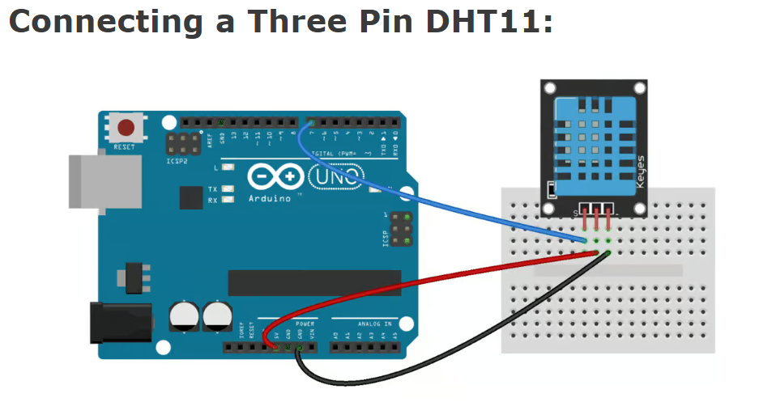

# DHT11 Driver from Scratch (Arduino, C++)

A bit-banged driver for the DHT11 temperature and humidity sensor, written in C++ for the Arduino **without any sensor library**. It implements the sensor's single-wire protocol directly: start signal, handshake, 40-bit data frame, and checksum verification. A small Python tool logs the readings from the serial port to a CSV file and plots them.

## Why this project

Most DHT11 tutorials call a library. This project talks to the sensor by driving and sampling one GPIO pin with microsecond-level timing, which means dealing with the things a library hides:

- a protocol with **no clock line**, where information is encoded in **pulse widths**
- **timeouts**, so a faulty sensor can never freeze the program
- **data integrity**, using the sensor's checksum

### Wiring




## How the protocol works

The DHT11 uses one bidirectional data line that idles HIGH through the pull-up resistor. A full read has four phases.
-add screenshot
The 40 bits arrive most-significant-bit first and form five bytes:

| Byte | Content |
|---|---|
| 0 | humidity, integer part |
| 1 | humidity, decimal part (0 on the DHT11) |
| 2 | temperature, integer part |
| 3 | temperature, decimal part (0 on the DHT11) |
| 4 | checksum = lowest 8 bits of (byte 0 + byte 1 + byte 2 + byte 3) |

## Driver design

| Function | Job |
|---|---|
| `sendStartSignal()` | Pulls the line LOW for 20 ms, releases it for 40 us, then switches the pin to `INPUT` so the sensor can answer without a bus conflict. |
| `measurePulse(level, timeout)` | Measures how long the pin stays at `level`, using `micros()`. Returns `-1` if the pulse lasts longer than `timeout`. |
| `sensorResponse()` | Verifies the handshake: wait for the sensor to pull the line LOW (this synchronizes with its timing), then ~80 us LOW, then ~80 us HIGH. |
| `readBit()` | Waits for the LOW separator to end, times the HIGH pulse, and compares it against a threshold of 40 us (between ~27 us for `0` and ~70 us for `1`). Both waits have timeouts and return `-1` on failure. |
| `readHT()` | Runs the sequence, assembles 40 bits into 5 bytes (shift first, then OR in the new bit), verifies the checksum, and returns humidity and temperature. |

### Design decisions

- **Resynchronize on every edge.** An early version used fixed delays to sample each bit. The sensor has its own clock, so those open-loop delays drifted out of step and the code eventually waited forever for an edge that never came. Waiting for the real edges at every bit removes the drift.
- **Thresholds, not exact values.** `micros()` has 4 us resolution on a 16 MHz Arduino, and `digitalRead()` itself takes a few microseconds, so a 27 us pulse can measure as anywhere from about 24 to 32 us. Deciding `0` or `1` by comparing against a point between the two nominal widths is robust to that.
- **Every wait has a timeout.** A disconnected or misbehaving sensor produces an error message instead of a hang.
- **No slow operations inside the 40-bit loop.** A `Serial.println` per bit fills the 64-byte transmit buffer, and the resulting block makes the program miss the sensor's remaining bits. The loop only reads; printing happens afterwards.
- **The checksum guards transmission, not decoding.** It detects corrupted bits on the wire. It cannot catch a decoding bug that affects all bytes consistently, because such a bug can keep the sum valid (an off-by-one shift that doubled every byte did exactly this during development), so the decoded values were also checked against known conditions.


## Build and run

### 1. Arduino driver

1. Wire the sensor as above.
2. Open `arduino/dht11_driver/dht11_driver.ino` in the Arduino IDE, select your board and port, and upload.
3. Open the Serial Monitor at **9600 baud**. You should see one reading per line.

The sketch's `loop()` prints each successful reading as a single machine-readable line, so the Python logger can parse it:

```cpp
if (ok) {
  Serial.print(t);
  Serial.print(',');
  Serial.println(h);      // e.g.  23,41
}
```

Error messages (`No response`, `Sum is wrong!`, `Something wrong:`) are printed as plain text.

### 2. Python logger
**Close the Arduino Serial Monitor first.** Only one program can hold the port at a time.

The logger appends one row per reading and echoes any non-reading lines from the Arduino:

```
timestamp,temperature_c,humidity_pct
2025-01-01T12:00:00,23,41
```

Stop it with Ctrl+C.

### 3. Plot

```bash
python plot_log.py dht11_log.csv                 # show a window
python plot_log.py dht11_log.csv --save plot.png # save an image
```

## Results
-to add


